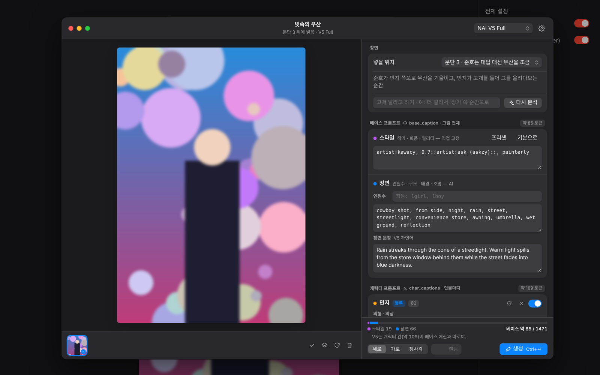

# Crack Painter

크랙(crack.wrtn.ai) 채팅 답변을 읽고 장면을 골라 NovelAI로 삽화를 그려 넣는 유저스크립트.



## 설치

1. [Tampermonkey](https://www.tampermonkey.net/) 또는 [Violentmonkey](https://violentmonkey.github.io/) 설치
2. **[crack-painter.user.js 설치하기](https://raw.githubusercontent.com/w7k4x9/crack-painter/main/crack-painter.user.js)**
3. 크랙 채팅방 오른쪽 메뉴 → **AI 삽화 (Crack Painter)** 를 눌러 설정 열기
4. **연결**에 키를 넣고 확인을 눌러
   - **NovelAI 토큰** (`pst-…`): 그림 생성용
   - **Gemini 키** (`AIza…`, [AI Studio](https://aistudio.google.com/apikey)에서 무료) 또는 DeepSeek 키: 채팅을 읽고 장면을 고르는 용도
   - 분석 AI를 **안 씀**으로 하면 NovelAI 토큰만으로 쓸 수 있어. 대신 장면 태그는 직접 써야 해.

업데이트는 같은 링크로 덮어써서 설치하면 돼. 스크립트를 지우고 새로 설치하면 확장 프로그램 저장소(키 포함)도 같이 지워져.

## 쓰는 법

AI 답변 아래에 버튼 두 개가 붙어.

- **그림+반짝임** — 스튜디오 열기. AI가 장면을 고르면 칸별 프롬프트를 확인·수정하고 생성.
- **번개** — 바로 생성. 분석과 생성을 한 번에 하고 알림으로 알려줘.

오른쪽 메뉴의 **삽화 갤러리**에서 지금까지 만든 삽화를 날짜별로 모아 볼 수 있어(이 채팅방 / 전체). 크게 보기에서 저장, 프롬프트 복사, 채팅에서 보기, 스튜디오로 열기, 삭제가 돼.

채팅에 들어간 삽화 위에 마우스를 올리면 ‹ › 넘기기, 리롤, 스튜디오에서 편집, 저장, 삭제가 나와.

## 인원

설정 → 생성 옵션 → **그릴 인원**에서 고를 수 있어: 자동 / 1명 / 최대 2명 / 최대 3명. 채팅방마다 따로 정할 수도 있고, 1명일 때 꼭 그릴 인물도 지정할 수 있어. 인물이 한 명이면 베이스에 `solo`가 붙어.

## 프롬프트가 어느 칸에 들어가나

NovelAI V4+ 요청은 두 갈래야. 이 스크립트는 화면 구성부터 이 구조를 그대로 따르고, 칸마다 들어갈 수 있는 태그를 규칙으로 막아 둬.

| 칸 | 내용 | 누가 쓰나 |
|---|---|---|
| **베이스** `base_caption` · 스타일 | 작가 · 화풍 · 퀄리티 | 사용자 (설정 → 스타일, 프리셋) |
| **베이스** `base_caption` · 장면 | 인원수(자동) · 구도 · 배경 · 조명 (+ V5 장면 문장) | AI |
| **캐릭터** `char_captions[]` | 인물마다: 외형 · 의상 + 자세 · 표정 + (V5 인물 문장) | 외형은 사용자, 행동은 AI |

생성 직전에 이렇게 정리해:

- 캐릭터 외형 칸에 `artist:` 같은 작가·화풍·퀄리티 태그가 있으면 **베이스로 옮겨**. 설정의 캐릭터 화면에는 "스타일로 옮기기" 버튼도 떠.
- AI가 장면이나 행동 칸에 쓴 작가·퀄리티·인원수 태그와 인물 이름은 **빼**.
- 캐릭터 칸이 있으면 장면 칸의 머리색·눈색 같은 외형 태그도 빼. 베이스에 있으면 다른 인물에게까지 번지기 때문이야.
- 캐릭터 칸의 `1girl`, `1boy`는 `girl`, `boy`로 바꾸고, 인원수 태그는 베이스에 한 번만 넣어.

스튜디오 맨 아래 **실제로 보내는 내용**을 펼치면 NAI에 보내는 문자열이 칸별로 보여.

### 토큰 예산

- **V4.5**: 베이스와 모든 캐릭터 칸이 **512토큰을 나눠 써**. 그래서 게이지에도 합산으로 표시돼.
- **V5**: 베이스 예산(Full 1471 / Curated 703)을 캐릭터 칸과 따로 써.

게이지 숫자는 T5 토크나이저를 흉내 낸 추정치야.

## 저장 위치

| 무엇 | 어디 |
|---|---|
| API 키 | 유저스크립트 저장소 (`cp_secrets_v1`). 탭 사이에 캐시를 두지 않고, 바꾼 필드만 저장해. |
| 설정 · 캐릭터 · 스타일 | 유저스크립트 저장소 (`cp_settings_v1`) |
| 삽화 이미지 · 기록 | 이 브라우저의 IndexedDB (`crack-painter`). 채팅 안에 다시 띄우는 용도 |
| 내 폴더 (선택) | 설정 → 저장 공간 → **폴더에도 저장**. `폴더/채팅방 이름/날짜_제목_시드.png` (Chrome·Edge·Whale) |

폴더 지정이 안 되는 브라우저에서는 **생성할 때마다 다운로드**를 켜면 다운로드 폴더로 받아.

## 오류가 나면

알림의 **자세히**를 누르면 어느 서비스가 어떤 응답을 줬는지, 그리고 보낸 요청 요약이 나와. 키는 들어가지 않아. 그대로 복사해서 이슈에 붙여주면 돼.

## 개발

```sh
npm run build   # src/ → crack-painter.user.js
npm test        # 프롬프트 조립 · NAI 요청 · 응답 해석 단위 테스트
```

| 파일 | 역할 |
|---|---|
| `src/core.js` | 태그 분류, 칸별 조립, 토큰 추정 (DOM 없음) |
| `src/nai.js` | NAI V5/V4.5 요청 본문, 응답에서 이미지 꺼내기 |
| `src/llm.js` | 장면 분석 지시문, Gemini/DeepSeek 호출 |
| `src/store.js` | GM 저장소, IndexedDB |
| `src/crack.js` | 크랙 화면에서 메시지·문단 찾기 |
| `src/ui.js` `src/ui.css` | macOS 스타일 창·컨트롤·알림 (Shadow DOM) |
| `src/studio.js` `src/settings.js` | 스튜디오, 설정 창 |
| `src/app.js` | 생성 흐름, 채팅 안 삽화와 버튼 |
